     
  

👨‍💻 About Me

I'm a Software Engineer and React Developer based in India, passionate about building scalable, maintainable and user-focused applications.

I work across the MERN stack, combining modern frontend development with backend services and database design to turn ideas into functional products.

🔭 Building modern full-stack web applications
🌱 Exploring advanced React patterns and system design
⚡ Focused on clean code, performance and usability
🤝 Open to collaboration and new opportunities
🌐 Explore my portfolio
📫 Reach me at sujaljathar729@gmail.com
 
  

🛠️ Technical Arsenal

Programming Languages

Frontend Engineering

Backend & Databases

Development Tools & Platforms

🚀 Projects & Engineering Interests
Full-Stack Development	Frontend Engineering	Backend Development
MERN applications	Responsive interfaces	REST APIs
End-to-end workflows	Reusable React components	Database integration
Maintainable architecture	User experience	Application services

   
<!-- Add individual project cards here using verified repository names. -->
  

📊 GitHub Analytics

  

Contribution Activity
 

🏆 GitHub Achievements

  

🎮 Contributions in Motion

 
<b>👾 Pac-Man Contribution Graph</b>
   <picture> <source media="(prefers-color-scheme: dark)" srcset="https://raw.githubusercontent.com/Sujal829/Sujal829/output/output-pacman/pacman-contribution-graph-dark.svg" /> <source media="(prefers-color-scheme: light)" srcset="https://raw.githubusercontent.com/Sujal829/Sujal829/output/output-pacman/pacman-contribution-graph.svg" />  </picture> 

 
<b>🐍 Snake Contribution Animation</b>
    

🤝 Let's Build Something Great
Great software starts with curiosity, collaboration and a commitment to continuous improvement.

I'm open to software engineering opportunities, interesting projects and meaningful collaborations.

